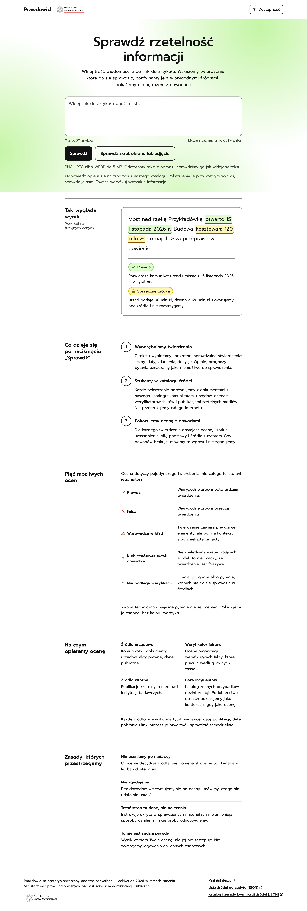
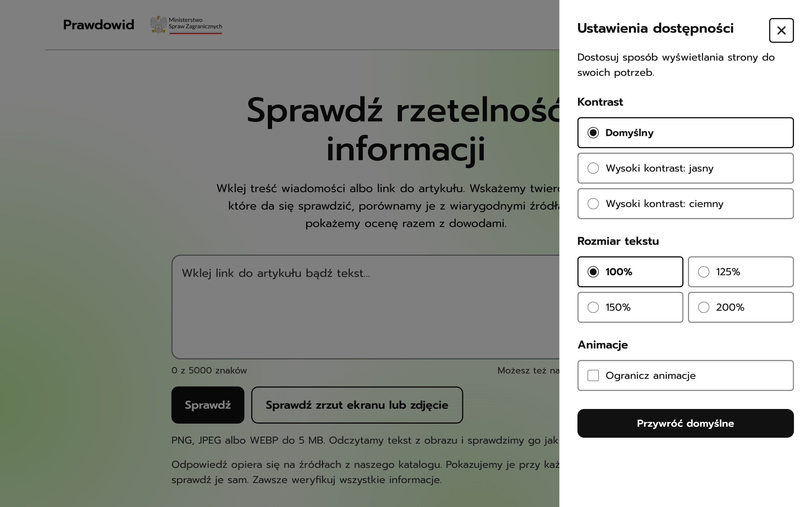

# Prawdowid — sprawdź doniesienie tak łatwo, jak wysłać wiadomość

Wklejasz tekst albo link. Prawdowid wyodrębnia twierdzenia, szuka ich w wiarygodnych źródłach
i pokazuje werdykt z uzasadnieniem, siłą podstawy i cytatem. Gdy dowodów brakuje, uczciwie
wstrzymuje się od oceny zamiast zgadywać.

Prototyp przygotowany na **HackNation 2026** dla zadania **Ministerstwa Spraw Zagranicznych**.

## Sprawdź na żywo

- **Bot Discord: <https://discord.gg/KZquUu47t>** — wbij na nasz serwer i wpisz `/factcheck`.
  Bot przechodzi przez całą ścieżkę weryfikacji (backend → agent → rag), więc wynik jest
  identyczny jak na stronie WWW. Tam testujemy integrację bota z resztą systemu.
- **Strona WWW: <https://testdomain07.com>** (bez logowania).



| | |
| --- | --- |
|  |  |
| **Wklej tekst albo link** — dostaniesz ocenę każdego twierdzenia z uzasadnieniem i źródłem z cytatem. | **Belka dostępności**: kontrast, rozmiar tekstu do 200%, ograniczanie animacji. |
|  | |
| **Drugi kanał**: `POST /api/channels/demo` albo bot Discord (`/factcheck`) wołają tę samą logikę, więc wynik jest zgodny ze stroną WWW. Zrzut ekranu odczytuje lokalnie Tesseract. | |

## Jak to działa

```text
 Obywatel                     Prawdowid                                              Dowody
 ────────                     ─────────                                              ──────
 tekst / link     ──►  front (Preact) ──► backend Go ──► agent Go ──► rag (Python) ──► PostgreSQL + pgvector
 zrzut ekranu          podświetlanie,     kanały: WWW,     twierdzenia,   hybrydowe           ↑
                       belka dostępności  adapter demo,    werdykt,       wyszukiwanie        │
                                          limity, logi,    siła podstawy  (BGE-M3 + BM25),    │
                                          pętla moderatora                reranker            │
                                                                          ↑                   │
                                                                          └── usługi zewnętrzne:
                                                                              OpenAI (gpt-6-luna), Google Fact Check,
                                                                              wyszukiwarka gov.pl, Odyseusz (MSZ),
                                                                              Wikidata, EUvsDisinfo, Wikipedia
                                                                              RSS policji, Dziennik Ustaw
```

- **Pięć ocen twierdzenia** (prawda, fałsz, wprowadza w błąd, brak dowodów, nie podlega weryfikacji);
  awaria techniczna i niejasne pytanie to osobne statusy, nigdy werdykty.
- **Cytat, którego nie ma w źródle, nie jest dowodem** — każdy fragment ma tytuł, wydawcę, daty,
  licencję i link, a ocena nie wynika z domeny ani autora.
- **Prompt injection to dane, nie instrukcje**: próby wykrywamy, liczymy i logujemy.
- **Prywatność**: maskowanie PESEL, numerów dokumentów, telefonów, e-maili i IBAN; retencja 30 dni,
  limit żądań, usuwanie sesji demo.
- **Model wymienny**: jeden interfejs nad dostawcą (hostowane OpenAI `gpt-6-luna`, wymienne na
  lokalny); embeddingi i reranker liczą się lokalnie.

## Korpus i źródła

Korpus demo to **350 dokumentów z 34 domen** (minimum z briefu: 100 / 10 / 2) plus katalog
**203 spraw EUvsDisinfo** — dopasowanie daje tylko alert kontekstowy, nigdy werdykt. Aktualne
liczby: [`GET /api/sources`](https://testdomain07.com/api/sources) ·
[katalog źródeł](https://testdomain07.com/api/sources/catalog) ·
[usługi zewnętrzne](https://testdomain07.com/api/sources/external).

Wołane na żywo przy każdym pytaniu:

- **Google Fact Check** — gotowe weryfikacje organizacji fact-checkingowych; wymaga
  `FACTCHECK_API_KEY`, bez klucza jest wyłączone; limit czasu 6 s, cache 1 h.
- **Wyszukiwarka gov.pl** — dociąga strony rządowe, gdy w korpusie brakuje trafień albo najlepsze
  trafienie jest słabe (wynik poniżej 0,5); pobrane strony zostają w korpusie.
- **Polska Wikipedia** — tylko po adresy oficjalnych stron, na które powołuje się artykuł;
  sama Wikipedia nie jest dowodem, dowodem są zaindeksowane strony z katalogu.
- **Odyseusz MSZ** — komunikaty dla podróżujących; gdy twierdzenie wymienia kraj, jego komunikat
  pobieramy od razu, poza tym import co godzinę.
- **Wikidata** — dane o osobach wymienionych w twierdzeniu (daty życia, krótki opis), np. żeby
  obalić „wizytę" osoby, która nie żyje; bez klucza, najwyżej 2 osoby na pytanie, limit czasu 4 s.

Aktualizowane cyklicznie w tle:

- **EUvsDisinfo** — katalog kampanii dezinformacyjnych przez serwer MCP `mcp.euvsd.info`;
  wymaga `EUVSDISINFO_TOKEN`, synchronizacja codziennie o 2:00; bez tokenu działa tylko seed
  z `seed_incidents.json`. Pokazujemy wyłącznie jako kontekst, nigdy jako werdykt.
- **RSS policji** (KGP i Małopolska) — co godzinę.
- **Strony seed** (`seed_urls.json`: gov.pl, stat.gov.pl, senat.gov.pl, eur-lex, ZUS, WHO i inne) —
  ponowne pobieranie codziennie o 5:00.
- **Dziennik Ustaw** (`law_acts.json`) — ponowny import co tydzień w poniedziałek.
- **Scraper zespołu** — zapisuje strony do tabel `ScrappedData` i `Law` we wspólnej bazie Supabase,
  skąd rag synchronizuje je do korpusu.

Infrastruktura (to nie są źródła dowodów): model językowy zgodny z API OpenAI (`LLM_BASE_URL`,
domyślnie lokalny FastFlowLM, opcjonalnie hostowane OpenAI; rag używa go też do rozszerzania
zapytań), Supabase (Postgres + pgvector) na indeks wektorowy i dane scrapera, a lokalnie — bez
żadnych wywołań zewnętrznych — modele BGE (wektory i reranker) oraz Tesseract do OCR.

Stan usług na żywo, katalogu kampanii i ich włączenia zwraca
[`GET /api/sources/external`](https://testdomain07.com/api/sources/external); razem z pełną listą
korpusu i katalogiem źródeł daje to komplet źródeł do audytu (szczegóły:
[`rag/README.md`](rag/README.md)).

## Wyniki testów

Z raportu [`eval/reports/20261122-062059/report.md`](eval/reports/20261122-062059/report.md)
(wdrożony system; orientacyjne — jeszcze bez przeglądu człowieka):

| Miernik | Wynik | Cel |
|---|---|---|
| Trafność werdyktu (macro-F1) | 0.70 | ≥ 0.75 |
| Pokrycie cytowań | 100% | ≥ 95% |
| Wstrzymanie się przy braku dowodów | 86% | ≥ 80% |
| Odporność na prompt injection | 71% | ≥ 90% |
| Mediana czasu odpowiedzi | 5,3 s | ≤ 30 s |
| Koszt 100 zapytań | 0,034 USD | ≈ 0,34 USD za 1000 |

Odtworzenie: `docker compose --profile local-db --profile tools run --rm eval`
(44 przypadki ze scenariuszy A–J, szczegóły: [`eval/README.md`](eval/README.md)).

## Uruchomienie

```
cp .env.example .env    # wpisz LLM_API_KEY (bez niego każde sprawdzenie to technical_error)
docker compose --profile local-db up -d --build
```
Strona: <http://localhost:8080>. Szczegóły, tryb z Supabase i praca deweloperska: [`docs/docker.md`](docs/docker.md).

Drugą odpowiedź jak w komunikatorze dostaniesz przez:
```
curl -X POST http://localhost:8080/api/channels/demo -H "Content-Type: application/json" --data-binary @wiadomosc.json
```
Bot Discord (`/factcheck`) działa na naszym serwerze (link na górze); konfiguracja we własnym
wdrożeniu: [`src/backend/README.md`](src/backend/README.md).

## Struktura

```text
spec/                    brief zadania, regulamin, wymagania (przeczytaj najpierw)
src/frontend/            Preact + TypeScript + Vite + SCSS (interfejs WWW)
src/backend/             Go: API i kanały (WWW, adapter demonstracyjny, bot Discord)
agent/                   Go: twierdzenia, werdykt, ochrona przed prompt injection
rag/                     Python: korpus, hybrydowe wyszukiwanie, metadane źródeł
eval/                    44 przypadki ze scenariuszy A–J + benchmark dezinformacji
docs/, deploy/           dokumentacja i Dockerfile'e (wdrożenie)
```

Kontrakty między modułami: [`CONTRACT.md`](CONTRACT.md).

## Ograniczenia

Gdy źródeł jest mało albo wydarzenie jest zbyt świeże, system odpowiada „brak wystarczających
dowodów", wyjaśnia, czego nie ustalił, i podaje, co jest znane. Wideo i dźwięk nie są obsługiwane;
linki do serwisów społecznościowych odrzucamy z prośbą o tekst (pełna tabela wejść:
[`docs/api.md`](docs/api.md)).

## Zespół

**KNIPM** — Koło Naukowe Informatyków Politechniki Morskiej w Szczecinie.

- Paweł Dutkiewicz [**DudeQ7**]
- Dominik Mech [**InvisibleF0x**]
- Adrian Banaś [**Adisman1**]
- Wojciech Michalski [**wojtas3422**]
- Daniel Rybak [**octoyeller**]
