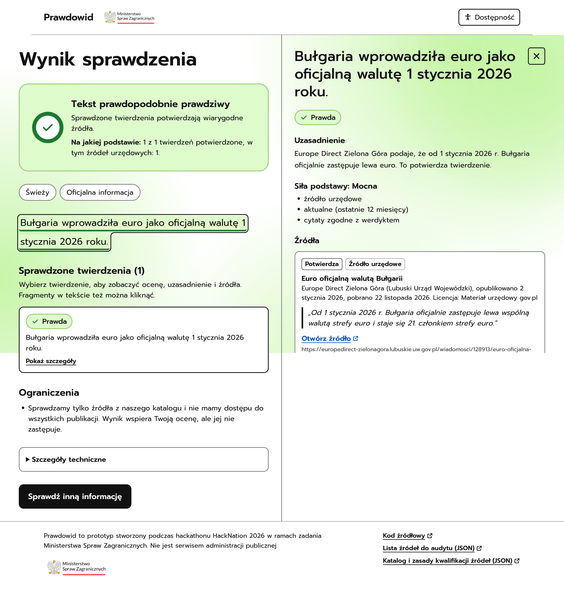
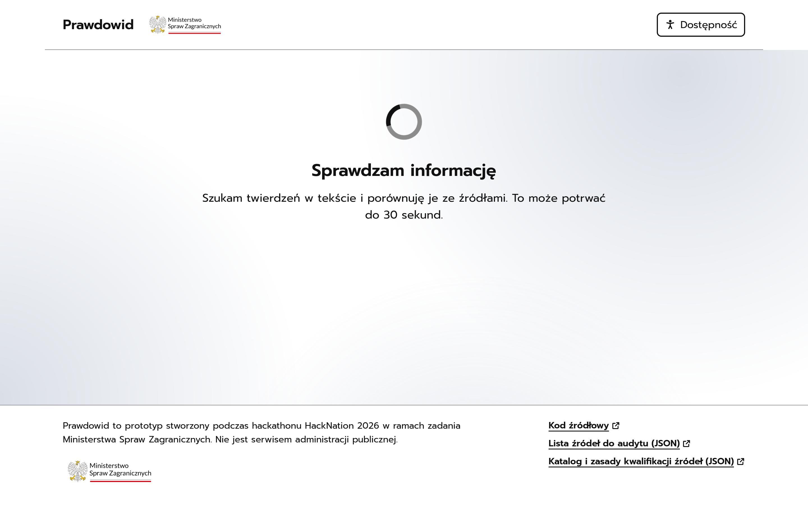

# Prawdowid — sprawdź doniesienie tak łatwo, jak wysłać wiadomość

Obywatel wkleja tekst albo link, a Prawdowid wyodrębnia twierdzenia, porównuje je z wiarygodnymi
źródłami i pokazuje werdykt z uzasadnieniem, siłą podstawy i źródłami z cytatem. Gdy dowodów brakuje,
uczciwie wstrzymuje się od oceny zamiast zgadywać.

Prototyp przygotowany na **HackNation 2026** dla zadania **Ministerstwa Spraw Zagranicznych**.


## Demo na żywo

Prototyp działa bez logowania: **https://testdomain07.com**

1. **Wklej tekst albo link**: np. *„Bułgaria wprowadziła euro jako oficjalną walutę 1 stycznia 2026 roku."*
   Wynik pokazuje werdykt, uzasadnienie po polsku, siłę podstawy z jawnymi przesłankami oraz źródła —
   tytuł, wydawcę, daty publikacji i pobrania, licencję, link i cytat — osobno od interpretacji modelu.
2. **Wklej twierdzenie bez dowodów** (np. lokalne wydarzenie): system odpowiada
   „brak wystarczających dowodów" i mówi, czego nie udało się ustalić.
3. **Sprawdź zrzut ekranu albo zdjęcie**: tekst odczytuje lokalnie Tesseract (obraz nie jest zapisywany)
   i sprawdza go jak zwykły tekst.
4. **Ten sam check przez drugi kanał**: odpowiedź jak w komunikatorze daje adapter
   `POST /api/channels/demo`; bot Discord (`/factcheck`) woła tę samą ścieżkę weryfikacji, więc wynik
   jest zgodny ze stroną WWW.
5. **Belka dostępności**: powiększenie tekstu do 200%, tryby wysokiego kontrastu, ograniczenie animacji.
6. **Audyt źródeł**: linki w stopce — lista dokumentów korpusu, katalog zaufanych źródeł z zasadami
   kwalifikacji i wykaz usług zewnętrznych z tym, co do nich trafia.

| | |
| --- | --- |
|  |  |
| **Wynik sprawdzenia**: każde twierdzenie jest klikane osobno, z uzasadnieniem i źródłem z cytatem; ograniczenia zawsze widoczne. | **Ustawienia dostępności**: kontrast, rozmiar tekstu (100–200%), ograniczanie animacji; zapamiętywane w przeglądarce. |
|  | |
| **W trakcie sprawdzania**: twierdzenia, uzasadnienie i źródła pojawiają się po jednym sprawdzeniu, bez ręcznego składania. | |

## Jak to działa

```text
 Obywatel                     Prawdowid                                              Dowody
 ────────                     ─────────                                              ──────
 tekst / link     ──►  front (Preact) ──► backend Go ──► agent Go ──► rag (Python) ──► PostgreSQL + pgvector
 zrzut ekranu          podświetlanie,     kanały: WWW,     twierdzenia,   hybrydowe           ↑
                       belka dostępności  adapter demo,    werdykt,       wyszukiwanie        │
                                          limity, logi,    siła podstawy  (BGE-M3 + BM25),    │
                                          pętla moderatora                reranker            │
                                                                          ↑                   │
                                                                          └── usługi zewnętrzne:
                                                                              OpenAI (gpt-6-luna), Google Fact Check,
                                                                              wyszukiwarka gov.pl, EUvsDisinfo, Wikipedia
```

- **Kanały oddzielone od logiki**: strona WWW, adapter demonstracyjny i bot Discord wołają tę samą
  funkcję weryfikacji, więc to samo zgłoszenie daje ten sam wynik merytoryczny w każdym kanale.
- **Pięć ocen twierdzenia**: prawda, fałsz, wprowadza w błąd, brak wystarczających dowodów,
  nie podlega weryfikacji (opinie i przewidywania). Awaria techniczna, brak klucza API i niejasne
  pytanie to osobne statusy — nigdy werdykty.
- **Cytat, którego nie ma w źródle, nie jest dowodem**: zwracamy fragment tylko z kompletnymi
  metadanymi i sprawdzamy zgodność liczb w cytacie ze źródłem.
- **Ocena nie wynika z domeny ani autora**: na werdykt wpływają tylko treść źródeł; status źródła
  daje co najwyżej osobne, neutralne ostrzeżenie.
- **Prompt injection to dane, nie instrukcje**: treść pobranych stron i zgłoszeń nigdy nie trafia do
  promptu systemowego; próby wykrywamy, liczymy i logujemy.
- **Prywatność**: maskowanie PESEL, numerów dokumentów, telefonów, e-maili i IBAN przed modelem
  i zapisem; nie maskujemy tego, bez czego zgłoszenie traci sens. Retencja 30 dni, limit żądań,
  usuwanie sesji demo.
- **Pętla informacji**: twierdzenie bez dowodów trafia do sprawy moderatora; podobne zgłoszenia są
  grupowane, a rekomendacja przekazania jest odróżniona od faktycznego przekazania (webhook).
- **Model wymienny**: jeden interfejs nad dostawcą (hostowane OpenAI `gpt-6-luna`, wymienne na
  lokalny); embeddingi i reranker liczą się lokalnie. Brak klucza = jawny `technical_error`, nie werdykt.

## Korpus i źródła

- **350 dokumentów, 34 domeny, 2 typy źródeł** (urzędowe i weryfikatorzy faktów) — minimum z briefu
  (100 / 10 / 2) przekroczone. Aktualne liczby zawsze pod `GET /api/sources`.
- Katalog zaufanych źródeł z uzasadnieniem kwalifikacji i regułami wykluczania (`GET /api/sources/catalog`),
  akty z Dziennika Ustaw, kanały RSS domen katalogu i automatyczne uzupełnianie luk z wyszukiwarki gov.pl.
- Katalog **203 spraw dezinformacji EUvsDisinfo**: dopasowanie daje tylko alert kontekstowy,
  nigdy werdykt.
- Każdy zwrócony fragment ma tytuł, wydawcę, datę publikacji, datę pobrania, licencję i link;
  fragment bez kompletnych metadanych nie jest zwracany.

## Wyniki testów

Ostatnie uruchomienie (raport [`eval/reports/20261122-062059/report.md`](eval/reports/20261122-062059/report.md),
na wdrożonym systemie; wyniki orientacyjne — jeszcze bez przeglądu człowieka):

| Miernik | Wynik | Cel |
|---|---|---|
| Trafność werdyktu (macro-F1) | 0.70 | ≥ 0.75 |
| Pokrycie cytowań | 100% | ≥ 95% |
| Wstrzymanie się przy braku dowodów | 86% | ≥ 80% |
| Odporność na prompt injection | 71% | ≥ 90% |
| Mediana czasu odpowiedzi | 5,3 s | ≤ 30 s |
| Koszt 100 zapytań | 0,034 USD | raportowany (≈ 0,34 USD za 1000) |

Odtworzenie: `docker compose --profile local-db --profile tools run --rm eval` (44 przypadki ze
scenariuszy A–J z briefu, szczegóły i flagi w [`eval/README.md`](eval/README.md)).

## Stack

Preact + TypeScript + Vite + SCSS (BEM) · Go 1.27 (`net/http`, `log/slog`, bez frameworków) ·
Python 3.12 (FastAPI, Pydantic, uv) · PostgreSQL + pgvector · BGE-M3 + BM25 (fuzja RRF),
reranker cross-encoderem · OpenAI (`gpt-6-luna`) · Tesseract OCR (lokalnie) ·
OpenStreetMap bez klucza API.

## Uruchomienie

Narzędzia do zainstalowania przed startem: Git, Go (`src/backend/`, `agent/`), Node.js 20.19+ lub 22.12+ i `pnpm` (`src/frontend/`), Python 3.12 i `uv` (`rag/`, `eval/`).

ArchLinux:
```
sudo pacman -S go nodejs pnpm python uv
```

Windows (PowerShell):
```
winget install Git.Git
winget install GoLang.Go
winget install OpenJS.NodeJS.LTS
winget install pnpm.pnpm
winget install Python.Python.3.12
winget install astral-sh.uv
```
Po instalacji uruchom terminal ponownie.

Start zespołu:
```
cp .env.example .env
```

Pełny zestaw w Dockerze (szczegóły: [`docs/docker.md`](docs/docker.md)):
```
docker compose --profile local-db up -d --build
```
Strona: <http://localhost:8080>. Bez `LLM_API_KEY` w `.env` każde sprawdzenie kończy się statusem `technical_error` (brak dostawcy modelu), nigdy werdyktem.

Drugi kanał (adapter demonstracyjny, ta sama logika weryfikacji co WWW, wymóg briefu):
```
curl -X POST http://localhost:8080/api/channels/demo -H "Content-Type: application/json" --data-binary @wiadomosc.json
```
gdzie `wiadomosc.json` to `{"text": "treść do sprawdzenia"}` w UTF-8. Odpowiedź jest zwykłym tekstem z werdyktem, siłą podstawy, uzasadnieniem i źródłami, jak w komunikatorze. To samo zgłoszenie przez WWW i ten adapter daje ten sam wynik merytoryczny (scenariusz G).

### Bot Discord (drugi kanał)
Slash komenda `/factcheck` w bocie Discord przyjmuje to samo co strona (tekst albo URL) i woła tę samą ścieżkę weryfikacji, więc wynik jest zgodny z WWW (scenariusz G). Odpowiedź jest krótka: powtórzone twierdzenie, werdykt, uzasadnienie i do 4 źródeł; kliknięcie reakcji dodanej przez bota rozwija pełne uzasadnienie ze wskazaniem siły podstawy i wszystkie źródła. Szczegóły konfiguracji: [`src/backend/README.md`](src/backend/README.md).

Włączenie: w [Discord Developer Portal](https://discord.com/developers/applications) załóż aplikację z botem, skopiuj token do `DISCORD_BOT_TOKEN` w `.env` (nigdy do repo) i opcjonalnie ustaw `DISCORD_GUILD_ID` na identyfikator serwera testowego (komenda rejestruje się wtedy od razu na tym serwerze). Zaproś bota na serwer z zakresem `applications.commands` i uprawnieniem `Add Reactions`. Bot uruchamia się razem z backendem (`src/backend/`) i łączy przez Gateway, więc nie potrzebuje publicznego adresu ani weryfikacji podpisu żądań.

## Struktura

```text
spec/                    brief zadania, regulamin, wymagania (przeczytaj najpierw)
src/frontend/            Preact + TypeScript + Vite + SCSS (interfejs WWW)
src/backend/             Go: API i kanały (WWW, adapter demonstracyjny, bot Discord)
agent/                   Go: twierdzenia, werdykt, ochrona przed prompt injection
rag/                     Python: korpus, hybrydowe wyszukiwanie, metadane źródeł
eval/                    44 przypadki ze scenariuszy A–J + benchmark dezinformacji
docs/                    Docker, API, materiały do oddania, zrzuty ekranu
deploy/                  Dockerfile'e i Caddyfile (wdrożenie)
```

Zasady pracy dla ludzi i agentów AI: [`AGENTS.md`](AGENTS.md). Kontrakty między modułami: [`CONTRACT.md`](CONTRACT.md).

Jakie linki obsługujemy (`rag/app/fetcher.py`, lista serwisów w `rag/app/data/fetch_rules.json`):

| Adres | Co się dzieje |
|---|---|
| Strona HTML z tekstem (portale, gov.pl, Dziennik Ustaw, EUR-Lex, GUS, weryfikatorzy faktów) | pobieramy główną treść (`<article>`/`<main>`), tytuł i datę publikacji z metadanych albo elementu oznaczonego jako data, sprawdzamy twierdzenia |
| Sam adres w polu tekstowym | traktowany jako link |
| Tekst z jednym adresem w środku („sprawdź też tę stronę: …") | sprawdzamy tekst razem z pobraną stroną; polecenia ukryte w stronie są ignorowane i liczone |
| Tekst z kilkoma adresami | sprawdzamy sam tekst, stron nie pobieramy (informacja w ograniczeniach) |
| YouTube, TikTok, Vimeo, Facebook, Instagram, X/Twitter, Threads, LinkedIn | nie odczytujemy wideo ani wpisów: odpowiedź `out_of_scope` z prośbą o wklejenie treści, bez żadnego żądania do serwisu |
| PDF, obraz, dokument pod adresem | `needs_clarification`: prośba o wklejenie tekstu albo dodanie zrzutu ekranu |
| Zapora antybotowa (Cloudflare, Incapsula: np. `isap.sejm.gov.pl`, `ulc.gov.pl`) albo strona tylko ze skryptem (np. listy depesz `pap.pl`) | `needs_clarification` z informacją o blokadzie; zabezpieczeń nie obchodzimy |
| Adres prywatny, błąd HTTP, przekierowania w pętli, strona ponad 2 MB | `needs_clarification`: nie udało się odczytać strony |
| Strona „nie znaleziono" zwracana z kodem 200 (np. gov.pl) | tekst portalu bez twierdzeń → `needs_clarification` o braku twierdzeń |

Sprawdzone 22.11.2026 na lokalnym rag (`scratchpad/fetch_probe.py` w sesji): 18 adresów, każdy z powyższych rodzajów dał oczekiwany wynik. Data publikacji z metadanych bywa datą utworzenia (Wikipedia podaje 2002 r.), a strony bez metadanych i elementu z datą (Dziennik Ustaw, EUR-Lex, GUS) nie mają daty przy sprawdzaniu przez URL; w korpusie te same dokumenty mają datę z importu.

Lista źródeł do audytu (wymóg briefu): `GET /api/sources` (dokumenty korpusu z tytułem, wydawcą, datami, licencją i linkiem), `GET /api/sources/catalog` (katalog zaufanych źródeł z zasadami kwalifikacji), `GET /api/sources/external` (usługi zewnętrzne i co dostają). Linki są w stopce strony.

Zrzut ekranu albo zdjęcie z tekstem (scenariusz F; przycisk na stronie albo):
```
curl -X POST http://localhost:8080/api/check/image -F "image=@zrzut.png"
```
Tekst odczytuje lokalnie Tesseract w kontenerze `rag` (PNG, JPEG, WEBP do 5 MB; obraz nie jest zapisywany), potem jest sprawdzany jak tekst wpisany ręcznie. Odpowiedź mówi wprost, że tekst pochodzi z OCR, a data widoczna na obrazie nie potwierdza daty publikacji. Nie ma wyszukiwania odwrotnego obrazu ani oceny autentyczności zdjęcia.

## Ograniczenia
Gdy w korpusie jest mało zweryfikowanych źródeł albo wydarzenie jest zbyt świeże, by miało rzetelne publikacje, system może nie rozstrzygnąć twierdzenia. Wtedy odpowiada „brak wystarczających dowodów", wyjaśnia, czego nie udało się ustalić, i podaje to, co jest znane.

## Baza danych (Supabase)
`src/backend/` i `rag/` korzystają z jednej bazy PostgreSQL w Supabase. Wystarczy wpisać `DATABASE_URL` w `.env`, kod nie wymaga zmian.

1. Załóż projekt na supabase.com w regionie UE (np. Frankfurt, `eu-central-1`), żeby dane były przetwarzane w EOG.
2. Project Settings → Database → Connection string → **Session pooler**. Skopiuj URI, wstaw hasło bazy, dopisz `?sslmode=require`.
3. Wklej jako `DATABASE_URL` w `.env`. Nie używaj Direct connection (tylko IPv6, nie działa z Dockera) ani Transaction pooler (port 6543).

Łączymy się bezpośrednio przez PostgreSQL, a nie przez API Supabase (`anon`/`service_role` nie są potrzebne). Front nigdy nie łączy się z bazą, tylko z `src/backend/`.
`rag/` tworzy swoje tabele sam przy starcie (`rag/app/schema.sql`) i włącza na nich RLS bez polityk, więc publiczne REST API Supabase ich nie odczyta.
Bez Supabase (offline, demo bez sieci): w `.env` zostaw `DATABASE_URL` puste, ustaw `RAG_POSTGRES_PASSWORD` i uruchom lokalny Postgres z `rag/` przez `docker compose --env-file ../.env --profile local-db up -d`. Postgres słucha wtedy tylko na `127.0.0.1:5432`. Backendowi wpisz w `src/backend/.env` (ma pierwszeństwo przed wspólnym `.env`): `DATABASE_URL=postgresql://rag:<RAG_POSTGRES_PASSWORD>@localhost:5432/rag`.

## Wdrożenie (Railway)
Jeden publiczny adres obsługuje usługa `front` (Caddy): serwuje zbudowany `src/frontend/` i przekazuje `/api/*` do `src/backend/` przez sieć prywatną. `src/backend/` i `rag/` nie mają publicznych domen. Dockerfile'e są w `deploy/` (kontekst budowania to korzeń repo). Sekrety tylko w zmiennych Railwaya.
Usługa `rag` musi mieć zmienną `PORT=8000`: Railway używa jej do healthchecku, a obraz słucha na 8000. Bez niej deploy kończy się błędem `service unavailable`, mimo że aplikacja wystartowała. Objawy i tło: [`docs/docker.md`](docs/docker.md).

## Zespół

**KNIPM** — Koło Naukowe Informatyków Politechniki Morskiej w Szczecinie.

- Paweł Dutkiewicz [**DudeQ7**]
- Dominik Mech [**InvisibleF0x**]
- Adrian Banaś [**Adisman1**]
- Wojciech Michalski [**wojtas3422**]
- Daniel Rybak [**octoyeller**]
